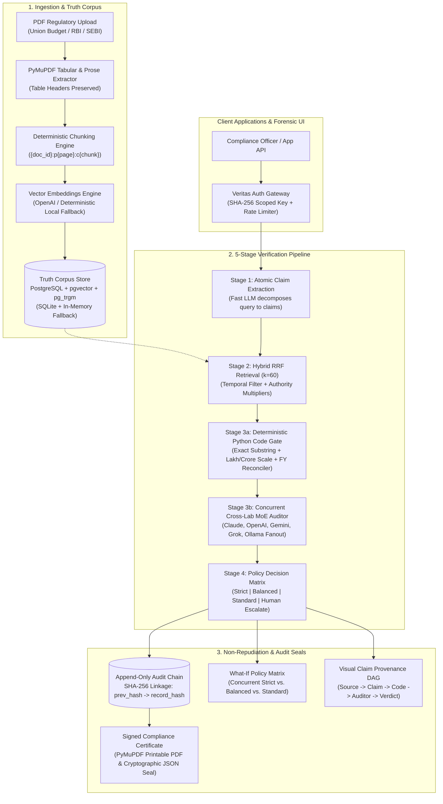

<div align="center">

# MNB VERITAS
### Multi-Model AI Verification & Anti-Hallucination Evidence Middleware

[](https://www.python.org/)
[](https://fastapi.tiangolo.com/)
[](https://nextjs.org/)
[](https://github.com/pgvector/pgvector)
[](backend/tests/)
[](LICENSE)

**MNB Veritas** is an enterprise-grade, evidence-gated verification middleware and forensic compliance workbench. It enforces deterministic anti-hallucination guardrails across multi-lab Large Language Models (Anthropic Claude, OpenAI GPT, Google Gemini, xAI Grok, and local Ollama) by subjecting AI outputs to exact verbatim quote matching, pure Python numeric and temporal boundary reconciliation, cross-lab adversarial auditing, and tamper-evident SHA-256 audit chaining.

</div>

---

## Table of Contents
1. [Core Verification Invariants](#core-verification-invariants)
2. [End-to-End System Architecture](#end-to-end-system-architecture)
3. [The 5-Stage Verification Pipeline](#the-5-stage-verification-pipeline)
4. [Source Governance & Authority Tiers](#source-governance--authority-tiers)
5. [Cryptographic Non-Repudiation & Certificates](#cryptographic-non-repudiation--certificates)
6. [Forensic Workbench & UI Capabilities](#forensic-workbench--ui-capabilities)
7. [Environment & Gateway Configuration](#environment--gateway-configuration)
8. [Complete REST & Streaming API Reference](#complete-rest--streaming-api-reference)
9. [Official Python Client SDK & CLI](#official-python-client-sdk--cli)
10. [Local Setup & Developer Quickstart](#local-setup--developer-quickstart)
11. [Automated Verification & Test Matrix](#automated-verification--test-matrix)

---

## Core Verification Invariants

MNB Veritas operates on a zero-mock, evidence-first governance philosophy. Every factual claim generated by an LLM is treated as unverified until it satisfies five non-negotiable invariants:

| Invariant | Name | Enforcement Mechanism |
|---|---|---|
| **#1** | **No Paraphrase Proof** | Every factual assertion must link character-for-character to an exact substring excerpt inside an approved truth chunk (`doc_id:p{page}:c{chunk}`). Paraphrases and synthetic citations are rejected. |
| **#2** | **Deterministic Code Over LLM** | Numeric values and scales are reconciled via deterministic Python regex and numeric parsers. Multipliers (`lakh` = $10^5$, `crore` = $10^7$, multi-currency, percentages) and Financial Year (`FY`) boundaries override any conflicting LLM claims. |
| **#3** | **Cross-Lab Independence & Anti-Collusion** | A secondary auditor model must run from a completely distinct provider lab (`auditor_lab != generator_lab`). Secondary audits fan out concurrently (`asyncio.gather`), skipping tripped circuit breakers in `0ms` to prevent latency bottlenecks. |
| **#4** | **Source Authority & Temporal Partitioning** | Truth sources are partitioned by temporal validity windows (`valid_from` to `valid_until`). Candidate sources are scored via Reciprocal Rank Fusion ($k=60$) weighted by statutory authority tiers (`statutory` > `regulatory` > `advisory` > `draft`). |
| **#5** | **Strict Policy Abstention** | Under `strict` policy, any failed citation, ungrounded external assertion, temporal expiration, or cross-lab dispute forces an unconditional `ABSTAIN` verdict with exact standardized answer `"No answer possible"`. |

---

## End-to-End System Architecture



---

## The 5-Stage Verification Pipeline

When a client submits a verification request (`POST /v1/verify` or `POST /v1/verify/stream`), MNB Veritas executes the following pipeline:

```
[Query Input] 
      │
      ▼
┌────────────────────────────────────────────────────────────────────────┐
│ STAGE 1: ATOMIC CLAIM EXTRACTION                                       │
│ • MoE Router selects fastest active provider (e.g. Gemini Flash Lite)  │
│ • Deconstructs synthesis into granular, testable claims                │
│ • Distinguishes factual claims from opinions or analytical summaries   │
└───────────────────────────────────┬────────────────────────────────────┘
                                    │
                                    ▼
┌────────────────────────────────────────────────────────────────────────┐
│ STAGE 2: AUTHORITY-WEIGHTED HYBRID RETRIEVAL (S2)                      │
│ • Enforces temporal boundary partitioning (valid_from <= ref_date)     │
│ • RRF Fusion (k=60): Cosine Vector Similarity + Trigram Fuzzy Search   │
│ • Multiplies scores by Authority Tier (Statutory: 1.5x, Regulatory: 1.2x)│
└───────────────────────────────────┬────────────────────────────────────┘
                                    │
                                    ▼
┌────────────────────────────────────────────────────────────────────────┐
│ STAGE 3A: DETERMINISTIC PYTHON CODE GATE                               │
│ • Exact verbatim character-level substring quote search                │
│ • Numeric Scale Normalization: Lakh (10^5) vs. Crore (10^7)            │
│ • Multi-currency reconciliation ($ / € / £ / ₹) and percentage checks  │
│ • Financial Year boundary matching (FY 2025-26 == FY26)                │
└───────────────────────────────────┬────────────────────────────────────┘
                                    │
                                    ▼
┌────────────────────────────────────────────────────────────────────────┐
│ STAGE 3B: CONCURRENT CROSS-LAB AUDITOR FANOUT                          │
│ • Enforces strict anti-collusion: Auditor Lab != Primary Generator Lab │
│ • Concurrent dispatch across candidate healthy labs via asyncio.gather │
│ • 0ms circuit breaker skip if provider circuit is OPEN                 │
└───────────────────────────────────┬────────────────────────────────────┘
                                    │
                                    ▼
┌────────────────────────────────────────────────────────────────────────┐
│ STAGE 4 & 5: POLICY DECISION & AUDIT CHAIN LINKAGE                     │
│ • STRICT: Reverts to 'No answer possible' on any failure               │
│ • BALANCED: Emits qualified synthesis with source warnings             │
│ • ESCALATE: Locks output pending designated human officer review       │
│ • Links record to append-only SHA-256 chain and computes tamper seal   │
└────────────────────────────────────────────────────────────────────────┘
```

---

## Source Governance & Authority Tiers

Truth sources are managed in `backend/app/models/db.py` (`VeritasSource`) with statutory authority classifications:

| Authority Tier | Multiplier | Description | Representative Documents |
|---|---|---|---|
| `statutory` | **1.50x** | Statutory Acts, Parliamentary Gazettes, Union Budget Schedules | Union Budget Outlay Schedule, Parliament Finance Act |
| `regulatory` | **1.20x** | Legally binding circulars, notifications, and master directions | RBI Monetary Policy Directives, SEBI Circulars |
| `advisory` | **1.00x** | Guidelines, consultative papers, and advisory recommendations | Ministry Consultation Papers, Draft Whitepapers |
| `draft` | **0.80x** | Working drafts, internal technical memos, unratified estimates | Preliminary Working Group Drafts |

### Tabular PDF Extraction
Using `PyMuPDF` (`fitz`), uploaded PDFs (`POST /v1/sources/upload`) are parsed into structured Markdown tables:
- Retains column headers and row context across split page breaks.
- Generates deterministic chunk identifiers: `{doc_id}:p{page}:c{chunk}`.
- Allows downstream exact substring quote matching to verify specific table cells without losing column-row relationships.

---

## Cryptographic Non-Repudiation & Certificates

To guarantee that compliance logs cannot be altered after the fact, MNB Veritas maintains a tamper-evident SHA-256 audit blockchain:

### 1. Zero-PII Audit Chain Linkage
Each audit log entry computes a cryptographic record hash:
$$\text{record\_hash} = \text{SHA-256}(\text{prev\_hash} \parallel \text{audit\_id} \parallel \text{canonical\_ts} \parallel \text{verdict} \parallel \text{policy} \parallel \text{models} \parallel \text{claim\_digest})$$
- `prev_hash`: Links sequentially to the preceding record hash (or `"GENESIS"` for record #1).
- `claim_digest`: Encodes claim outcome flags (`quote_verified`, `numeric_ok`, `fy_ok`, `cross_lab_ok`) without storing raw user prompt text or PII.
- Real-time tamper detection is exposed at `GET /v1/audits/verify-chain`.

### 2. Exportable Compliance Certificates (`GET /v1/audits/{audit_id}/certificate`)
- **Printable PDF (`?format=pdf`):** Renders a standalone A4 certificate using `PyMuPDF` with formal title blocks, color-coded verdict badges, cryptographic SHA-256 seal, primary/auditor model provenance, and verbatim source excerpts.
- **Cryptographic JSON Seal (`?format=json`):** Emits a canonical machine-readable certificate with `certificate_seal_sha256` for automated compliance pipelines.

---

## Forensic Workbench & UI Capabilities

The Next.js 15 forensic frontend (`frontend/src/components/VeritasApp.tsx`) exposes 5 specialized control surfaces:

### 1. Verification Workbench (`AuditWorkbench.tsx`)
- **Real-Time Synthesis & Verification:** Submit complex queries against active truth corpuses with custom policy modes and temporal reference dates.
- **What-If Policy Matrix:** Executes active queries concurrently across `strict`, `balanced`, and `standard` policies using `POST /v1/verify/batch`, displaying a 3-column side-by-side comparative matrix.
- **Visual Claim Provenance DAG (`ClaimProvenanceDAG.tsx`):** Displays a 5-node forensic flow for every claim (`Source Chunk` $\to$ `Claim` $\to$ `Code Gate` $\to$ `Auditor` $\to$ `Verdict`).
- **One-Click Certificate Export:** Direct download buttons for signed PDF compliance certificates and JSON cryptographic seals.

### 2. Forensic Benchmark Runner (`BenchmarkRunner.tsx`)
- Runs a 5-point adversarial stress battery testing Lakh-vs-Crore mismatches, temporal boundary violations, hallucinations, and multi-currency edge cases with real-time pass/fail indicators.

### 3. Truth Source Manager (`SourceManager.tsx`)
- Manage active truth corpuses, inspect chunked texts, modify temporal validity windows (`valid_from` / `valid_until`), assign authority tiers, and ingest regulatory PDFs via drag-and-drop.

### 4. Forensic Audit Log (`AuditLogsView.tsx` & `AuditLog.tsx`)
- Append-only forensic ledger displaying end-to-end telemetry (latency, token count, estimated cost, circuit state).
- Includes real-time SHA-256 chain verification badge (`VALID` vs. `TAMPERED`) and per-row certificate export.

### 5. API Key & Governance Manager (`ApiKeyManager.tsx`)
- Issue and revoke scoped per-application API keys (`X-Veritas-Key`), enforce policy mode ceilings, and set per-minute rate limits.

---

## Environment & Gateway Configuration

Create a `.env` file in the root directory (or copy from `.env.example`):

```bash
cp .env.example .env
```

### Key Configuration Variables

```ini
# Multi-Lab LLM Provider API Keys (Configure at least one live provider)
ANTHROPIC_API_KEY=your_anthropic_api_key_here
OPENAI_API_KEY=your_openai_api_key_here
GEMINI_API_KEY=your_gemini_api_key_here
XAI_API_KEY=your_xai_api_key_here

# Local LLM & Ollama (OpenAI-Compatible Gateway)
OLLAMA_BASE_URL=http://localhost:11434/v1
OLLAMA_MODEL=llama3.2:latest

# Model Overrides (Fast Extraction vs. Deep Auditor)
DEFAULT_ANTHROPIC_MODEL=claude-3-5-sonnet-20241022
FAST_ANTHROPIC_MODEL=claude-3-5-haiku-20241022
AUDITOR_ANTHROPIC_MODEL=claude-3-5-sonnet-20241022

DEFAULT_OPENAI_MODEL=gpt-4o-mini
FAST_OPENAI_MODEL=gpt-4o-mini
AUDITOR_OPENAI_MODEL=gpt-4o

DEFAULT_GEMINI_MODEL=gemini-3-flash-preview
FAST_GEMINI_MODEL=gemini-3-flash-preview
AUDITOR_GEMINI_MODEL=gemini-flash-lite-latest

DEFAULT_XAI_MODEL=grok-2
FAST_XAI_MODEL=grok-2
AUDITOR_XAI_MODEL=grok-2

# Governance & Security
DEFAULT_POLICY_MODE=strict
VERITAS_API_KEY=veritas-local-dev-key-2026
RATE_LIMIT_PER_MINUTE=60

# Circuit Breakers (0ms fast skip when tripped)
CB_FAILURE_THRESHOLD=1
CB_COOLDOWN_SECONDS=60.0

# Database & Cache (SQLite zero-dependency fallback by default)
DATABASE_URL=sqlite+aiosqlite:///./veritas.db
REDIS_URL=redis://127.0.0.1:6379/0

# Hybrid Retrieval (S2)
MAX_CANDIDATE_SOURCES=5
RRF_K=60
EMBEDDING_DIM=1536
EMBEDDING_MODEL=text-embedding-3-small
```

---

## Complete REST & Streaming API Reference

All protected endpoints require the authentication header:
```http
X-Veritas-Key: veritas-local-dev-key-2026
```

### Summary of API Endpoints

| Method | Endpoint | Description |
|---|---|---|
| `GET` | `/health` | System liveness, DB connection, and configured provider labs |
| `GET` | `/v1/health/providers` | Circuit breaker status and active/tripped count across all 5 labs |
| `POST` | `/v1/health/providers/{lab}/reset` | Manually reset a tripped circuit breaker to `CLOSED` |
| `POST` | `/v1/verify` | Execute synchronous 5-stage multi-lab verification |
| `POST` | `/v1/verify/stream` | Server-Sent Events (SSE) streaming real-time stage transitions |
| `POST` | `/v1/verify/batch` | Concurrently evaluate up to 50 items with aggregate summary |
| `GET` | `/v1/sources` | List all truth corpus documents with authority tiers and validity dates |
| `POST` | `/v1/sources` | Register a new text source into the truth corpus |
| `POST` | `/v1/sources/upload` | Ingest and chunk a regulatory PDF into structured Markdown tables |
| `PATCH` | `/v1/sources/{doc_id}/expiry` | Update source validity dates (`valid_until`) |
| `DELETE` | `/v1/sources/{doc_id}` | Archive/delete a truth source |
| `DELETE` | `/v1/sources/cleanup-test-data` | Purge synthetic benchmark and test sources |
| `GET` | `/v1/audits` | Query append-only audit trail with filtering and pagination |
| `GET` | `/v1/audits/verify-chain` | Cryptographic SHA-256 blockchain verification |
| `GET` | `/v1/audits/{audit_id}/certificate` | Export signed compliance certificate (`?format=pdf` or `?format=json`) |
| `POST` | `/v1/audits/{audit_id}/review` | Compliance officer sign-off on escalated audits |
| `POST` | `/v1/app-keys` | Generate a new scoped per-application API key |
| `GET` | `/v1/app-keys` | List active application API keys |
| `DELETE` | `/v1/app-keys/{key_id}` | Revoke an application API key |
| `POST` | `/v1/benchmark/run` | Execute the 5-point adversarial stress benchmark suite |

---

### Detailed Endpoint Specifications

#### 1. Execute Multi-Lab Verification (`POST /v1/verify`)
```bash
curl -X POST "http://127.0.0.1:8000/v1/verify" \
  -H "Content-Type: application/json" \
  -H "X-Veritas-Key: veritas-local-dev-key-2026" \
  -d '{
    "query": "What is the capital expenditure outlay for FY 2025-26?",
    "policy": "strict",
    "reference_date": "2025-02-01"
  }'
```

**Response (`200 OK`):**
```json
{
  "audit_id": "aud_b43fd87d",
  "verdict": "APPROVE",
  "answer": "Total capital expenditure outlay stands at Rs 11,11,111 crore for FY 2025-26.",
  "policy_applied": "strict",
  "telemetry": {
    "primary_model": "google:gemini-3-flash-preview",
    "auditor_model": "anthropic:claude-3-5-sonnet-20241022",
    "moe_route": "deep_audit",
    "circuit_state": "CLOSED",
    "failover_triggered": false,
    "latency_ms": 1420,
    "prompt_tokens": 580,
    "completion_tokens": 42,
    "estimated_cost_usd": 0.0024,
    "numeric_concord_pct": 100.0,
    "temporal_bound": "VALID"
  },
  "claim_audits": [
    {
      "claim_id": "c1",
      "claim_text": "Total capital expenditure outlay stands at Rs 11,11,111 crore for FY 2025-26.",
      "is_factual": true,
      "is_critical": true,
      "quote_verified": true,
      "source_expired": false,
      "numeric_mismatch": false,
      "fy_mismatch": false,
      "cross_lab_supported": true,
      "matched_doc_id": "doc_budget_2025:p1:c1",
      "verbatim_quote": "Total capital expenditure outlay stands at ₹11,11,111 crore for FY 2025-26."
    }
  ],
  "warnings": [],
  "created_at": "2026-11-24T10:51:16.300104Z"
}
```

---

#### 2. Batch Verification API (`POST /v1/verify/batch`)
Concurrently processes up to 50 verification requests bounded by `asyncio.Semaphore(10)`.

```bash
curl -X POST "http://127.0.0.1:8000/v1/verify/batch" \
  -H "Content-Type: application/json" \
  -H "X-Veritas-Key: veritas-local-dev-key-2026" \
  -d '{
    "items": [
      {
        "item_id": "req-strict",
        "query": "What is the green hydrogen outlay?",
        "policy": "strict"
      },
      {
        "item_id": "req-balanced",
        "query": "What is the green hydrogen outlay?",
        "policy": "balanced"
      }
    ]
  }'
```

**Response (`200 OK`):**
```json
{
  "total": 2,
  "successful": 2,
  "failed": 0,
  "results": [
    {
      "item_id": "req-strict",
      "status": "completed",
      "audit_id": "aud_a1b2c3d4",
      "verdict": "APPROVE",
      "answer": "Cabinet approves financial outlay of Rs 4,850 crore for FY 2025-26.",
      "latency_ms": 1180,
      "claims_count": 1,
      "claims_approved": 1
    }
  ],
  "summary": {
    "approved": 2,
    "qualified": 0,
    "abstained": 0,
    "escalated": 0,
    "avg_latency_ms": 1180.0
  }
}
```

---

#### 3. Export Compliance Certificate (`GET /v1/audits/{audit_id}/certificate`)

**Download Printable PDF Certificate:**
```bash
curl -s -X GET "http://127.0.0.1:8000/v1/audits/aud_b43fd87d/certificate?format=pdf" \
  -H "X-Veritas-Key: veritas-local-dev-key-2026" \
  -o "veritas-certificate-aud_b43fd87d.pdf"
```

**Fetch Canonical JSON Seal:**
```bash
curl -s -X GET "http://127.0.0.1:8000/v1/audits/aud_b43fd87d/certificate?format=json" \
  -H "X-Veritas-Key: veritas-local-dev-key-2026"
```

**JSON Seal Response (`200 OK`):**
```json
{
  "audit_id": "aud_b43fd87d",
  "issued_at_utc": "2026-11-24T10:51:16.300104Z",
  "verdict": "APPROVE",
  "policy_applied": "strict",
  "safe_to_publish": true,
  "primary_model": "google:gemini-3-flash-preview",
  "auditor_model": "anthropic:claude-3-5-sonnet-20241022",
  "prev_hash": "b2f6c9...",
  "record_hash": "4a1d8e...",
  "chain_verified": true,
  "certificate_seal_sha256": "1827b608710727e997a9f72cba04344e45d8b85b4fbe61faea40df3fe81ea624",
  "verified_quotes": [
    {
      "claim_id": "c1",
      "verbatim_quote": "Total capital expenditure outlay stands at ₹11,11,111 crore for FY 2025-26.",
      "matched_doc_id": "doc_budget_2025:p1:c1",
      "quote_verified": true,
      "numeric_mismatch": false,
      "fy_mismatch": false,
      "cross_lab_supported": true
    }
  ]
}
```

---

#### 4. Verify SHA-256 Audit Chain Integrity (`GET /v1/audits/verify-chain`)
```bash
curl -s -X GET "http://127.0.0.1:8000/v1/audits/verify-chain" \
  -H "X-Veritas-Key: veritas-local-dev-key-2026"
```

**Response (`200 OK`):**
```json
{
  "valid": true,
  "checked_count": 198,
  "latest_record_hash": "4a1d8e95...",
  "first_broken_audit_id": null,
  "details": "Audit log chain verified successfully across 198 records."
}
```

---

#### 5. Real-Time SSE Verification Stream (`POST /v1/verify/stream`)
```bash
curl -N -X POST "http://127.0.0.1:8000/v1/verify/stream" \
  -H "Content-Type: application/json" \
  -H "Accept: text/event-stream" \
  -H "X-Veritas-Key: veritas-local-dev-key-2026" \
  -d '{"query": "What is the repo rate?", "policy": "strict"}'
```

**Stream Events Emitted:**
```
data: {"stage": 1, "name": "RETRIEVAL", "message": "Retrieved 3 candidate regulatory documents", "progress": 20}
data: {"stage": 2, "name": "EXTRACTION", "message": "Extracted 1 claims using google:gemini-3-flash-preview", "progress": 40}
data: {"stage": 3, "name": "AUDIT", "message": "Deterministic code verified quotes and numeric concordance", "progress": 60}
data: {"stage": 4, "name": "DECISION", "message": "Applied STRICT policy -> Verdict: APPROVE", "progress": 80}
data: {"stage": 5, "name": "COMPLETE", "message": "Verification report generated successfully", "progress": 100}
```

---

## Official Python Client SDK & CLI

MNB Veritas provides an official Python SDK and CLI tool (`client/veritas/`) to embed evidence-gated verification directly into financial microservices, trading platforms, and automated compliance pipelines.

### 1. Installation
```bash
pip install -e client/
```

### 2. Async Python SDK Usage
```python
import asyncio
from veritas import VeritasClient

async def main():
    async with VeritasClient(api_url="http://127.0.0.1:8000", api_key="veritas-local-dev-key-2026") as client:
        # 1. Execute verification with strict anti-hallucination guardrails
        res = await client.verify(
            query="What is the revised Standing Deposit Facility rate effective January 2025?",
            policy="strict",
        )

        if res.is_approved:
            print(f"Verified Answer: {res.answer}")
            print(f"Primary Model  : {res.telemetry.primary_model}")
            print(f"Verified Quotes: {res.verified_quotes_count}")

            # 2. Export signed PDF compliance certificate
            pdf_bytes = await client.download_certificate(res.audit_id, format="pdf")
            with open(f"veritas-cert-{res.audit_id}.pdf", "wb") as f:
                f.write(pdf_bytes)
        else:
            print(f"Strict Abstention Triggered: {res.verdict} ({res.answer})")

asyncio.run(main())
```

### 3. Synchronous Blocking Usage
```python
from veritas import VeritasSyncClient

with VeritasSyncClient(api_url="http://127.0.0.1:8000") as client:
    res = client.verify("What is the green hydrogen pilot outlay?", policy="standard")
    print(res.verdict, res.answer)
```

### 4. CLI Tool Usage
```bash
# Verify a query from terminal
veritas verify "What is the capital expenditure outlay for FY 2025-26?" --policy strict --export-cert cert.pdf

# Verify cryptographic SHA-256 audit blockchain integrity
veritas chain

# Check provider circuit states and active models
veritas health

# Download signed compliance certificate by audit ID
veritas cert aud_b43fd87d --format pdf --out cert_b43fd87d.pdf
```

---

## Local Setup & Developer Quickstart

### Prerequisites
- Python 3.11, 3.12, or 3.13
- Node.js 18+ & npm
- Docker & Docker Compose (Optional for full-stack containerization)

### Option 1: Native Local Development (Zero Docker Required)

1. **Clone and Configure Environment:**
   ```bash
   git clone https://github.com/itzdevilsunny/mnb-veritas.git
   cd mnb-veritas
   cp .env.example .env
   # Add your GEMINI_API_KEY, ANTHROPIC_API_KEY, or OPENAI_API_KEY in .env
   ```

2. **Boot the FastAPI Backend:**
   ```bash
   # Install dependencies
   pip install -r backend/requirements.txt

   # Start backend on http://127.0.0.1:8000
   python -m uvicorn app.main:app --host 0.0.0.0 --port 8000 --app-dir backend
   ```

3. **Boot the Next.js Frontend:**
   ```bash
   cd frontend
   npm install
   npm run dev
   # Open http://localhost:3000 in your browser
   ```

---

### Option 2: One-Command Docker Production Deployment (Full Stack)

MNB Veritas ships with an enterprise multi-container deployment stack orchestrated via `docker-compose.yml`:
- **Database (`postgres`):** PostgreSQL 16 with pre-initialized `pgvector` (HNSW indexing) and `pg_trgm` (fuzzy trigram matching), healthchecked via `pg_isready`.
- **Cache & Rate Limiting (`redis`):** Redis 7 Alpine with persistent append-only storage, healthchecked via `redis-cli ping`.
- **Verification Engine (`backend`):** FastAPI Python 3.12 multi-stage slim container running under unprivileged user `veritas` with PyMuPDF, `asyncpg`, and auto-restarting workers on port `8000`.
- **Forensic UI (`frontend`):** Next.js 15 standalone Node 22 Alpine container running under unprivileged user `nextjs` with internal Docker bridge proxying to `http://backend:8000` on port `3000`.

```bash
# 1. Configure production environment
cp .env.example .env
# Set your GEMINI_API_KEY, ANTHROPIC_API_KEY, or OPENAI_API_KEY in .env

# 2. Build and launch all 4 healthy containers in detached mode
make up
# Or: docker compose up -d --wait --build

# 3. View container health and ports
make ps

# 4. Tail aggregated service logs
make logs

# 5. Execute live smoke and verification batteries against the container stack
python scripts/smoke_test.py
python -m veritas chain --url http://127.0.0.1:8000

# 6. Gracefully stop containers and preserve persistent database volumes
make down
```

#### Container Service Health Endpoints
| Service | Container Name | Port | Health Check Mechanism | Target |
|---|---|:---:|---|---|
| **PostgreSQL 16** | `mnb-veritas-postgres` | `5432` | `pg_isready -U veritas_user -d mnb_veritas` | Interval: 5s, Retries: 10 |
| **Redis 7** | `mnb-veritas-redis` | `6379` | `redis-cli ping` | Interval: 5s, Retries: 10 |
| **FastAPI Backend** | `mnb-veritas-backend` | `8000` | `curl -f http://127.0.0.1:8000/health` | Interval: 10s, Retries: 8 |
| **Next.js Frontend** | `mnb-veritas-frontend` | `3000` | `wget --spider http://127.0.0.1:3000/` | Interval: 10s, Retries: 8 |

---

## Automated Verification & Test Matrix

MNB Veritas maintains a comprehensive, zero-mock test suite across backend unit logic, integration routes, and end-to-end multi-lab workflows.

### Running Test Batteries

```bash
# 1. Run full 80-test pytest suite
PYTHONPATH=backend python -m pytest backend/tests/ -v

# 2. Run live server smoke test
python scripts/smoke_test.py

# 3. Run 9-phase comprehensive end-to-end workflow test
python scripts/test_full_workflow.py

# 4. Run live multi-policy workbench test
python scripts/test_live_workbench_battery.py

# 5. Verify frontend TypeScript types
cd frontend && npx tsc --noEmit
```

### Verified Test Matrix

| Test Suite | File | Tests | Coverage Area | Status |
|---|---|:---:|---|:---:|
| **Adversarial Stress** | [`test_adversarial_stress.py`](file:///c:/Users/Pinky/Desktop/mnb%20research/mnb%20veritas/backend/tests/test_adversarial_stress.py) | 13 | Lakh/Crore 100x scale traps, ungrounded inventions, temporal boundaries, cross-lab isolation, concurrency | **PASSED** |
| **API Integration** | [`test_api_integration.py`](file:///c:/Users/Pinky/Desktop/mnb%20research/mnb%20veritas/backend/tests/test_api_integration.py) | 6 | Health endpoints, provider reset, PDF upload, sources lifecycle, verify flow, benchmark | **PASSED** |
| **Auth & Rate Limiting** | [`test_auth_rate_limit.py`](file:///c:/Users/Pinky/Desktop/mnb%20research/mnb%20veritas/backend/tests/test_auth_rate_limit.py) | 6 | SHA-256 API key hashing, constant-time compare, policy scoping, HTTP 429 Retry-After | **PASSED** |
| **Circuit Breakers** | [`test_circuit_breaker.py`](file:///c:/Users/Pinky/Desktop/mnb%20research/mnb%20veritas/backend/tests/test_circuit_breaker.py) | 5 | CLOSED $\to$ OPEN trip, half-open cooldown, manual reset, multi-lab status | **PASSED** |
| **Policy & Human Review** | [`test_escalation_and_profiles.py`](file:///c:/Users/Pinky/Desktop/mnb%20research/mnb%20veritas/backend/tests/test_escalation_and_profiles.py) | 3 | ESCALATE verdict, designated compliance officer sign-off, scoped policy restrictions | **PASSED** |
| **Hybrid RRF Retrieval** | [`test_hybrid_retrieval.py`](file:///c:/Users/Pinky/Desktop/mnb%20research/mnb%20veritas/backend/tests/test_hybrid_retrieval.py) | 6 | Cosine vector similarity, trigram matching, RRF $k=60$ fusion, authority tiers, temporal filters | **PASSED** |
| **Numeric & FY Parser** | [`test_numeric_parser.py`](file:///c:/Users/Pinky/Desktop/mnb%20research/mnb%20veritas/backend/tests/test_numeric_parser.py) | 14 | Exact quote normalization, lakh/crore scale, percentages, multi-currency, FY boundary regex | **PASSED** |
| **Option B Enhancements** | [`test_option_b_enhancements.py`](file:///c:/Users/Pinky/Desktop/mnb%20research/mnb%20veritas/backend/tests/test_option_b_enhancements.py) | 6 | Tabular PDF extraction to Markdown, split table headers, authority multipliers, local embeddings | **PASSED** |
| **Option C Batch & Chain** | [`test_option_c_batch_and_chain.py`](file:///c:/Users/Pinky/Desktop/mnb%20research/mnb%20veritas/backend/tests/test_option_c_batch_and_chain.py) | 4 | Batch verification limits, scoped policy checks, sequential SHA-256 audit chaining, tamper detection | **PASSED** |
| **Option D Certificates** | [`test_option_d_certificates.py`](file:///c:/Users/Pinky/Desktop/mnb%20research/mnb%20veritas/backend/tests/test_option_d_certificates.py) | 5 | JSON compliance certificate schema, PyMuPDF printable PDF rendering, 404/401 handlers | **PASSED** |
| **Client SDK & CLI** | [`test_client_sdk.py`](file:///c:/Users/Pinky/Desktop/mnb%20research/mnb%20veritas/backend/tests/test_client_sdk.py) | 2 | Async/sync Python client verification, batching, certificate downloads, CLI parser | **PASSED** |
| **Policy Gate Invariants** | [`test_policy_gate.py`](file:///c:/Users/Pinky/Desktop/mnb%20research/mnb%20veritas/backend/tests/test_policy_gate.py) | 4 | STRICT abstention on missing citation, numeric/FY mismatch, empty corpus | **PASSED** |
| **Security & Supabase** | [`test_security_parser.py`](file:///c:/Users/Pinky/Desktop/mnb%20research/mnb%20veritas/backend/tests/test_security_parser.py) + [`test_supabase_integration.py`](file:///c:/Users/Pinky/Desktop/mnb%20research/mnb%20veritas/backend/tests/test_supabase_integration.py) | 8 | Hyphenation joining, token boundaries, Supabase health checks, unconfigured fallbacks | **PASSED** |
| **TOTAL** | | **82** | **100% Passing (0 failures, 0 errors)** | **GREEN** |

---

## License

This project is licensed under the Apache 2.0 License. See the [LICENSE](LICENSE) file for details.
